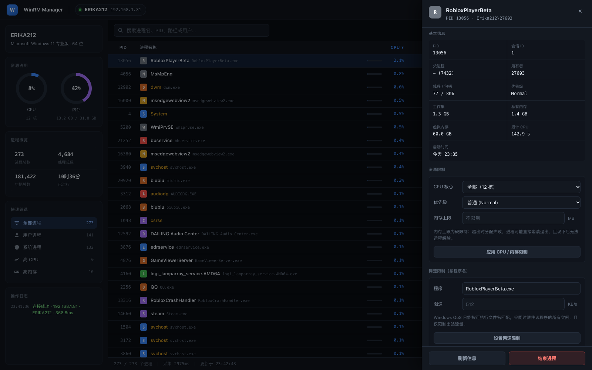
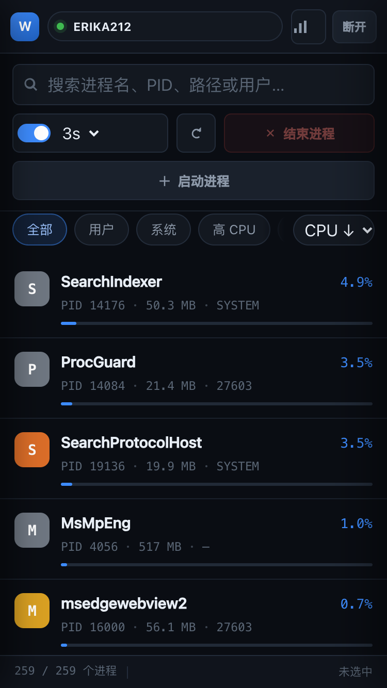
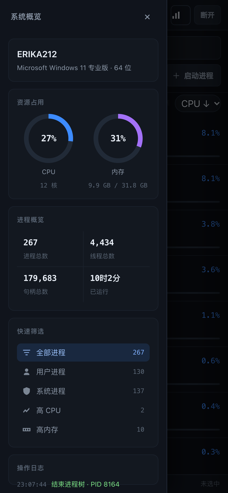
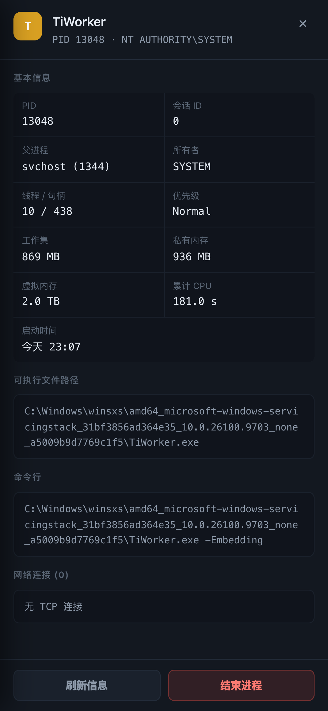
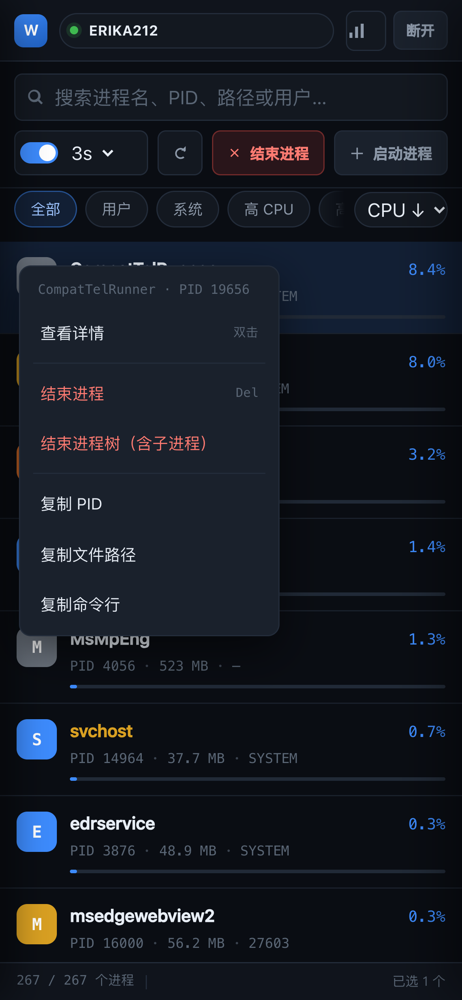
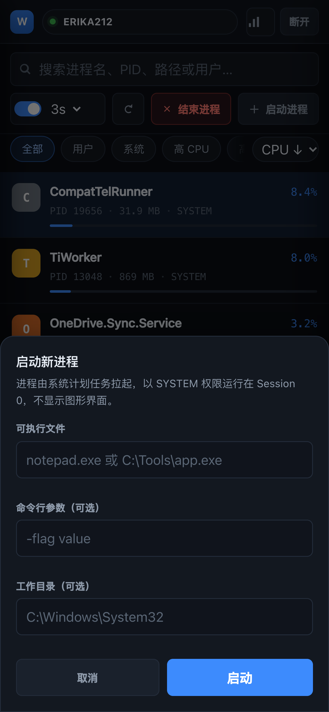
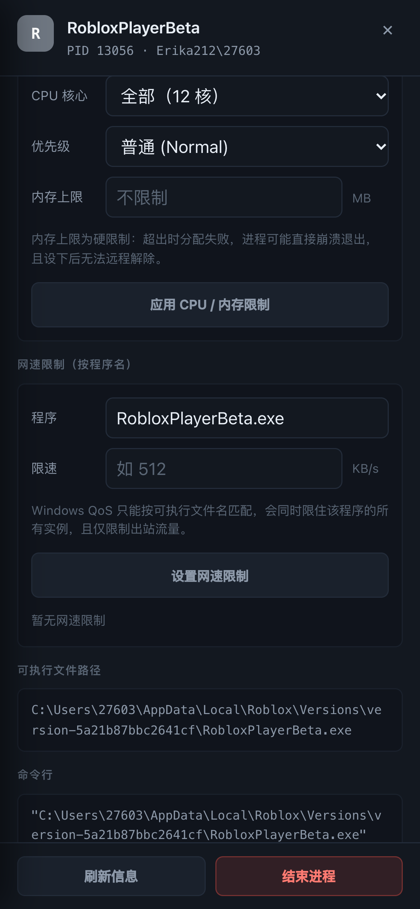
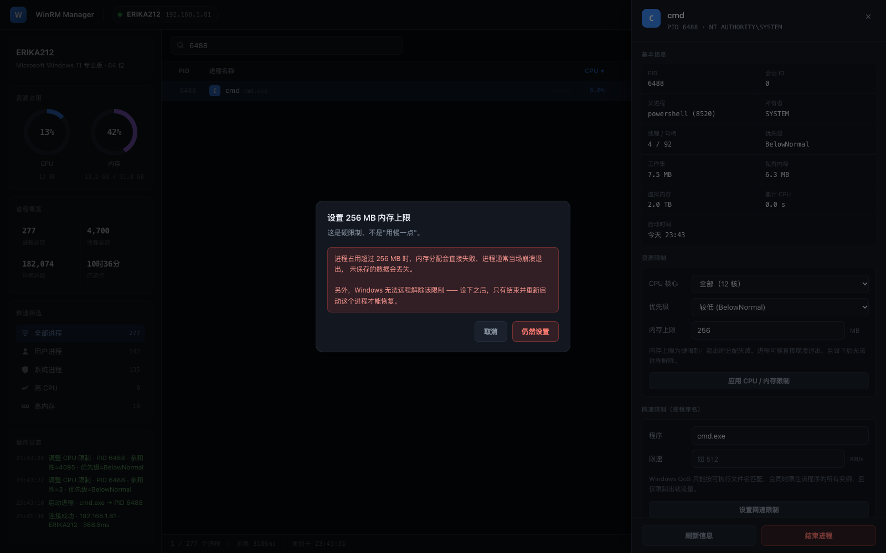

# WinRM Manager

在浏览器里远程管理 Windows 主机的进程 —— 实时查看进程列表、CPU/内存占用、结束进程（支持进程树）、启动新进程。目标机无需安装任何客户端，只要启用 WinRM。

- **飞牛 fnOS**：打成 `.fpk` 包，在应用中心上传即可安装
- **macOS**：下载 `.app` 双击运行，内置依赖无需安装

---

## 界面预览

桌面端进程列表：



移动端（窄屏自动切换为卡片布局）：

| 进程列表 | 系统概览 | 进程详情 |
|:---:|:---:|:---:|
|  |  |  |
| **长按菜单** | **启动进程** | **资源限制** |
|  |  |  |

设置内存上限时的二次确认（该限制不可远程撤销）：



---

## 在飞牛 NAS 上安装

1. 从 [Releases](https://github.com/peterxulove/winrm-manager/releases) 下载最新的 `winrmmanager_x.x.x_x86.fpk`
   （或自己用 `build_nas/build_fpk.sh` 构建）
2. 打开飞牛桌面 → **应用中心** → 找到「上传应用 / 手动安装」入口，选中该 `.fpk` 文件
3. 按向导填写两项：
   - **Web 访问端口**：默认 `5178`
   - **Web 访问密码**：必填。这个密码用于保护界面，避免局域网内其他人操作你的 Windows 主机
4. 安装完成后，桌面会出现 **WinRM Manager** 图标，点击即可打开

也可以直接访问 `http://<NAS的IP>:5178`。

> **架构说明**：当前包内含 **x86_64** 二进制依赖，适用于 J3455 / J4125 / N100 / N305 等 Intel、AMD 机型。
> ARM 机型（如 RK3588）需用 `build_nas/build_fpk.sh arm` 自行构建。

### 安装后发生什么

| 项目 | 位置 |
|---|---|
| 程序目录 | `/var/apps/winrmmanager/target` |
| 配置与日志 | `/var/apps/winrmmanager/var/` |
| 运行用户 | `root`（需监听端口、写系统临时目录） |
| 服务端口 | 安装时填写的端口，默认 5178 |

升级或重装时配置目录保留，访问密码不会丢失。

---

## 在 macOS 上运行

从 [Releases](https://github.com/peterxulove/winrm-manager/releases) 下载 `WinRM-Manager-macOS.zip`，解压后双击 `WinRM Manager.app` 即可。

- 应用是**自包含**的：服务端代码与 Python 依赖都打包在 `.app` 内部，**不需要 pip install**
- 内置依赖兼容 **Python 3.9–3.13**，macOS 自带的 `/usr/bin/python3` 也能直接运行
- 首次打开若提示「无法验证开发者」，**右键点图标 → 打开**
- 服务在后台运行，日志在 `~/.winrm-manager/server.log`

> 当前构建为 Apple Silicon（arm64）。Intel Mac 上会回退使用系统 Python 的依赖，需要先执行 `pip3 install pywinrm requests-ntlm`。

从源码直接跑（开发调试用）：

```bash
pip3 install pywinrm requests-ntlm
./启动.command
```

自行构建自包含 `.app`：

```bash
cd build_mac && ./build_mac.sh    # 产物在 build_mac/dist/
```

---

## 使用

### 首次连接 Windows 主机

在登录页填写目标机信息：

| 项 | 说明 |
|---|---|
| 主机地址 | 如 `192.168.1.81` |
| 用户名 | 属于 Administrators 组的账号 |
| 密码 | 该账号密码 |
| 端口 | `5985`（HTTP）/ `5986`（HTTPS） |
| 认证方式 | 首选 `NTLM` |

勾选「记住主机与账号」后，下次会自动填好（**密码从不保存**）。

### 资源限制

双击进程打开详情，在「资源限制」区块里可以针对**单个进程**调整 CPU、内存和网速。三项的能力和风险完全不同，用之前请看清：

| 项目 | 机制 | 效果 | 能否撤销 |
|---|---|---|---|
| **CPU 核心** | 处理器亲和性（Affinity） | **硬限制**。绑到 N 个核，进程真的用不到别的核 | ✅ 随时改回「全部」 |
| **优先级** | PriorityClass | **软限制**。系统忙时优先让出 CPU，空闲时仍可跑满 | ✅ 随时调整 |
| **内存上限** | Job Object 硬上限 | **硬限制**。超过上限时内存分配直接失败，进程通常当场崩溃 | ❌ **无法远程撤销** |
| **网速** | Windows QoS | 按**程序名**限速，仅限出站 | ✅ 可删除策略 |

几个必须知道的细节：

**内存上限是「硬杀」不是「限速」。** 它不是让进程"用得慢一点"，而是超过阈值就分配失败。适合「防止某个进程吃光内存拖垮机器」，不适合「温柔地限制它」。设下之后 Windows 无法远程解除 —— 只有结束并重启该进程才能恢复。界面会二次确认。

**网速限制只能按程序名。** Windows QoS 的匹配条件是应用路径（如 `chrome.exe`），没有按 PID 的选项。所以它会同时限住该程序的所有实例，且只限制**出站**流量。想按单个进程实例限速，需要第三方驱动（NetLimiter 那类），Web 应用做不到。

**CPU 限制是最安全的一项。** 亲和性绑定和优先级调整都是进程级属性，随时可以改回来，不影响进程运行。想给某个吃满 CPU 的进程降降温，优先用这个。

> 限制策略由 Windows 自身执行，即使关掉本应用也继续生效（内存限制尤其如此）。

### 进程操作

| 操作 | 方式 |
|---|---|
| 查看详情 | 双击进程行 |
| 结束进程 | 选中后按 `Delete`，或工具栏「结束进程」，或右键菜单 |
| 批量结束 | `⌘`/`Ctrl` + 点击多选，再点「结束进程」 |
| 结束进程树 | 右键 → 「结束进程树」，或确认框里勾选「同时结束所有子进程」 |
| 启动进程 | 工具栏「启动进程」，填写可执行文件与参数 |
| 复制信息 | 右键 → 复制 PID / 文件路径 / 命令行 |

### 快捷键

| 键 | 作用 |
|---|---|
| `⌘F` / `Ctrl+F` | 聚焦搜索框 |
| `R` | 立即刷新 |
| `Delete` | 结束选中进程 |
| `Esc` | 关闭抽屉 / 对话框 / 右键菜单 |

### 自动刷新

默认 3 秒，可选 2/3/5/10 秒。鼠标停在表格上时会暂停重绘，避免打断双击和文本选择。

### 手机 / 平板访问

手机浏览器直接打开 `http://<NAS的IP>:5178` 即可，无需装 App。界面会自动切换为移动端布局：

| 桌面 | 手机 |
|---|---|
| 七列表格 | 卡片列表（名称 + CPU% + PID/内存/用户） |
| 固定侧边栏 | 抽屉式侧边栏，点顶部柱状图图标展开 |
| 表头点击排序 | 筛选条右侧的下拉排序 |
| 右键菜单 | **长按卡片**弹出同样的菜单 |
| 右侧详情抽屉 | 全屏详情页 |
| 侧边栏筛选 | 工具栏下方的横向筛选按钮 |

其他移动端处理：

- 点击卡片直接打开详情
- 输入框字号 ≥16px，避免 iOS 聚焦时自动放大
- 适配 iPhone 刘海/底部横条安全区
- 横向溢出已消除，320px 极窄屏（iPhone SE 一代）也能正常显示
- 可「添加到主屏幕」，以全屏方式打开

> 手机端为了信息密度做了取舍：卡片只显示名称、CPU、PID、内存和用户名。完整信息（命令行、路径、端口、父进程）点开详情查看。

---

## 连接前：在 Windows 上启用 WinRM

在**目标机**以管理员身份打开 PowerShell：

```powershell
Enable-PSRemoting -Force
Set-Item WSMan:\localhost\Client\TrustedHosts -Value "*" -Force   # 仅测试环境
```

确认：

```powershell
Get-Service WinRM            # 应为 Running
Test-WSMan -ComputerName localhost
```

在 NAS 或 Mac 上确认端口可达：

```bash
nc -z -w 3 192.168.1.81 5985
```

---

## 从源码构建 fpk

```bash
cd build_nas
./build_fpk.sh          # x86_64
./build_fpk.sh arm      # ARM64
```

产物输出到 `build_nas/dist/`。脚本会自动下载对应架构的 Linux 依赖 wheel、计算 `app.tgz` 的 MD5 并写入 manifest，无需手工干预。

修改代码后重新执行即可，`build_nas/assets/` 下是与平台相关的固定文件（生命周期脚本、图标、配置模板）。

---

## 项目结构

```
winrm-manager/
├── server.py                  后端（标准库 HTTP + WinRM 封装，零第三方 Web 框架）
├── static/                    前端单页应用
│   ├── index.html
│   ├── style.css
│   └── app.js
├── build_nas/                 飞牛 fpk 构建
│   ├── build_fpk.sh           一键构建脚本
│   ├── assets/                生命周期脚本、图标、配置模板
│   ├── test_linux.py          容器内业务链路测试
│   └── dist/
│       └── winrmmanager_1.0.4_x86.fpk
├── 启动.command                macOS 本地运行（终端模式）
├── 停止服务.command
└── build_mac/                  macOS .app 构建
    ├── build_mac.sh            一键构建自包含 .app
    └── assets/                 launcher 与图标
```

### fpk 包内部结构

```
winrmmanager_1.0.4_x86.fpk  (tar.gz)
├── manifest                  名称、版本、架构、install_type、app.tgz 的 MD5
├── app.tgz                   程序本体：server.py + static/ + vendor/ + bin/ + ui/
├── cmd/                      生命周期脚本（install / upgrade / start / stop / status / uninstall）
├── config/
│   ├── privilege             run-as root
│   └── resource              服务声明
├── wizard/                   安装向导（端口、访问密码）与卸载向导
├── ICON.PNG                  64×64
└── ICON_256.PNG              256×256
```

包结构与飞牛官方第三方应用（NginxManager、WebServer 等）保持一致：
根目录不放 `ui/`（它在 `app.tgz` 内），文件属主统一为 `root`。

---

## 故障排查

### 安装失败

安装器弹窗里的提示文字会直接显示原因。如果没有提示，在 NAS 的 SSH 里查看：

```bash
cat /tmp/winrmmanager_install.log
```

常见原因：

| 现象 | 原因 | 处理 |
|---|---|---|
| 提示"内置依赖无法加载" | Python 版本过老，或机器是 ARM | 确认是 x86_64 机器且 Python ≥ 3.9 |
| 提示"系统缺少 python3" | 系统被精简 | 恢复 python3 后重装 |
| 提示"版本过低" | Python < 3.9 | 升级系统 |
| 提示端口被占用 | 5178 已有服务 | 向导里换端口 |
| 无任何提示直接失败 | 包格式或架构校验未过 | 见下 |

安装日志（应用自身的运行日志）在：

```bash
cat /var/apps/winrmmanager/var/server.log
```

### 安装时提示 python3 不存在

`install_init` 会检查系统 python3。fnOS 基于 Debian，默认自带；若被精简掉，需要先恢复。

### 安装成功但打不开

```bash
# 在 NAS 上查看日志
cat /var/apps/winrm-manager/var/server.log
```

常见原因：

- 端口被占用 —— 在应用设置里换一个端口
- 访问密码没填 —— 重装时向导里必须填写

### 连接 Windows 报「无法连接到主机」

- 目标机 WinRM 未启用，或防火墙没放行 5985
- NAS 与目标机不在同一网段
- 先 `nc -z -w 3 <IP> 5985` 确认端口通

### 报「认证失败」

- 优先用 **NTLM**；`Basic` 需要在 Windows 端额外开启
- 域环境可改用 `Kerberos`（NAS 侧需先 `kinit`）

### 启动的进程立刻消失 / 看不到界面

这是 WinRM 的固有限制：WinRM 会话本身是一个 Job Object，直接 `Start-Process` 拉起的子进程会随会话结束被回收。

本项目已绕过 —— 改用**计划任务**拉起进程（由 Task Scheduler 服务创建，脱离 WinRM 会话）。因此：

- 启动的进程以 **SYSTEM** 身份运行在 **Session 0**
- **不显示图形界面**，适合启动后台服务、脚本、常驻程序
- 需要界面交互的程序（记事本、浏览器）不适用此通道

### 结束进程被拒绝（403）

`system`、`lsass`、`csrss`、`services`、`svchost`、`dwm` 等系统关键进程有硬性保护，结束它们会导致蓝屏或网络中断。后端会直接拒绝，绕过前端也一样。

---

## 技术说明

### 数据链路

```
浏览器 ──HTTP──> NAS 上的 server.py ──WSMan/NTLM──> Windows 目标机
```

### 为什么后端不用 Flask

fpk 包需要在 NAS 上离线运行，不能假设有 pip 环境。因此 HTTP 层改用 Python 标准库 `http.server`，整个后端只依赖 `pywinrm` 及其链（`requests` / `requests-ntlm` / `cryptography` / `pyspnego`）。

这些依赖以**预解压的 vendor 目录**形式打包进 `app.tgz`：

```
vendor/common/     纯 Python 包 + cryptography(abi3)，跨版本通用
vendor/cp311/      cffi —— C 扩展，按 Python 主次版本区分
vendor/cp312/
vendor/cp313/
```

`bin/run.sh` 启动时读取 `sys.version_info`，自动挂载匹配的目录到 `PYTHONPATH`。因此 NAS 上无论 Python 是 3.9 还是 3.13，都能直接运行，**不需要联网、不需要 pip install**。

### 两个关键实现细节

1. **中文不乱码** —— PowerShell 输出统一 `ConvertTo-Json` 后转 `Base64(UTF-8)`，Python 端解码，绕开 WinRM 默认 OEM 代码页。

2. **参数零转义** —— 所有用户输入（PID 列表、文件路径、命令行参数）编码成 `Base64(UTF-8 JSON)` 注入 PowerShell，由脚本内 `ConvertFrom-Json` 还原。路径里的空格、引号、中文、反斜杠都不会破坏脚本。

### 性能

单次进程采集 0.8–1.3 秒（250 个进程），系统信息约 2 秒。系统信息只在连接时和手动刷新时拉取，不参与自动刷新。

---

## 安全设计

- **Web 访问密码**：NAS 部署时强制设置，所有 API 请求需带 token
- **系统进程保护**：16 类关键进程硬性拦截
- **安装类型**：`install_type = root`（符合飞牛原生应用规范）；服务只监听配置端口、只读写自己的数据目录
- **密码不落盘**：前端不保存 Windows 密码；NAS 上的访问密码存在 `var/config.env`，权限 600
- **目录穿越防护**：静态文件服务做了路径规范化校验
